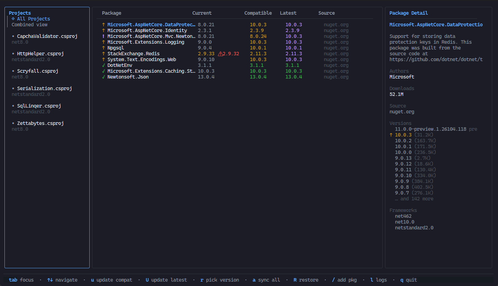

<div align="center">

# guget


**Manage NuGet packages across your .NET projects, right from the terminal.**

[](https://github.com/nulifyer/guget/actions/workflows/ci.yml)
[](https://github.com/nulifyer/guget/releases/latest)
[](https://marketplace.visualstudio.com/items?itemName=nulifyer.guget)
[](https://github.com/nulifyer/guget/blob/main/guget/go.mod)


</div>



Browse your solution, compare package versions, and update dependencies without
opening each project file. Use the interactive terminal UI for day-to-day work
or the headless CLI for scripts and agents.

## Features

| | Feature | What you can do |
| :-: | --- | --- |
| 📦 | Package management | Search, add, update, and remove NuGet references. |
| 🗂️ | Multi-project view | Browse C#, F#, and VB projects together and update a package across projects. |
| ⬆️ | Version picker | Compare available versions, see framework compatibility hints, and choose a release. |
| 🛡️ | Vulnerability notices | See known vulnerabilities and deprecation notices when metadata is available. |
| 🌐 | Public and private feeds | Use configured NuGet sources and Package Source Mapping. |
| 🔗 | Shared versions | Work with Central Package Management and supported imported props files. |
| 🌳 | Dependency trees | Inspect package dependencies and a project's full transitive graph. |
| 📝 | Release notes | Browse GitHub releases and NuSpec notes alongside your packages. |
| 🔄 | Restore | Run restore for a selected project or the workspace. |
| 🖱️ | Keyboard and mouse | Navigate panels, select versions, open links, and use visible action buttons. |
| 🎨 | Themes and layout | Choose light or dark themes, resize panels, and sort package lists. |
| ⌨️ | CLI for scripts and agents | Inspect JSON, preview scoped changes, and manage packages without the TUI. |
| 🧩 | VS Code integration | Open Guget in an editor tab from project files, the command palette, or the status bar. |

<a id="installation"></a>

## Install

Install the [.NET SDK](https://dotnet.microsoft.com/download), then install Guget.

Linux and macOS:

```bash
curl -fsSL https://raw.githubusercontent.com/nulifyer/guget/main/.scripts/install.sh | bash
```

Windows PowerShell:

```powershell
irm https://raw.githubusercontent.com/nulifyer/guget/main/.scripts/install.ps1 | iex
```

You can also [download a release](https://github.com/nulifyer/guget/releases).
See [installation and updates](docs/installation.md) for custom locations,
source builds, and upgrading Guget.

## Try it

Open a directory containing your .NET projects:

```bash
guget --project ./src
```

Select a project, press `Tab` to focus its packages, and press `v` to choose a
version. Press `?` for keyboard help. The TUI needs a terminal of at least
80 columns by 12 rows and supports both keyboard and mouse navigation.

For scripts and agents, inspect packages or preview an update without opening
the TUI:

```bash
guget list --project ./src --format json
guget update Newtonsoft.Json --version 13.0.4 --project ./src --file App/App.csproj --dry-run --format json
```

The example assumes `src/App/App.csproj` exists. Replace the package, version,
and paths with your own.

## Guides

- [Use the TUI](docs/tui.md): navigate, add, update, remove, restore, and browse package details.
- [Use the CLI](docs/cli.md): explicit project scope, JSON output, and scripting examples.
- [Configure package sources](docs/sources.md): public and private feeds, source mapping, and local feeds.
- [Work with supported projects](docs/project-support.md): CPM, shared props, version expressions, and editing limits.
- [Troubleshoot problems](docs/troubleshooting.md): PATH, authentication, restore, and incomplete results.

Want to contribute? See [CONTRIBUTING.md](CONTRIBUTING.md).
