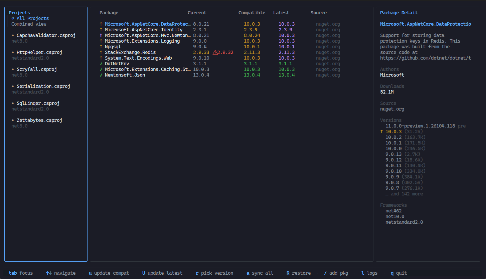

# guget for VS Code

**Manage NuGet packages in an interactive terminal UI inside your editor.**

Browse packages across C#, F#, and VB projects without leaving your editor.

## Features

| | Feature | What you can do |
| :-: | --- | --- |
| 🧩 | Editor integration | Launch from project files, the command palette, or the status bar. |
| 🗂️ | Multi-project view | Browse your workspace and update a package across projects. |
| 📦 | Package management | Search, add, update, and remove NuGet references. |
| ⬆️ | Version picker | Compare available versions and framework compatibility hints before choosing a release. |
| 🛡️ | Vulnerability notices | See known vulnerabilities and deprecation notices when metadata is available. |
| 🌐 | Public and private feeds | Use configured NuGet sources and Package Source Mapping. |
| 🔗 | Shared versions | Work with Central Package Management and supported imported props files. |
| 🌳 | Dependency trees | Inspect package dependencies and a project's full transitive graph. |
| 📝 | Release notes | Browse GitHub releases and NuSpec notes. |
| 🔄 | Restore | Run restore for a selected project or the workspace. |
| 🖱️ | Keyboard and mouse | Navigate panels, select versions, open links, and use action buttons. |
| 🎨 | Themes and layout | Match your terminal theme, resize panels, and sort package lists. |

## Get started

1. Install the [.NET SDK](https://dotnet.microsoft.com/download).
2. Install the [Guget CLI](https://github.com/nulifyer/guget/blob/main/docs/installation.md).
3. Install this extension from the [VS Code Marketplace](https://marketplace.visualstudio.com/items?itemName=nulifyer.guget).
4. Open a folder containing `.csproj`, `.fsproj`, or `.vbproj` files.
5. Open the command palette and run **Guget: Manage NuGet Packages**.

Guget opens in an editor terminal tab. Give the tab at least 80 columns and
12 rows. Press `?` for help or read the [TUI guide](https://github.com/nulifyer/guget/blob/main/docs/tui.md).

## Open a project directory

Right-click a project file in Explorer, or use its editor title button, and
choose **Guget: Manage NuGet Packages**. This opens the project's directory,
including other projects under that directory. Select an individual project
inside Guget to narrow package actions.

The status-bar **guget** item opens the workspace flow. In a multi-root
workspace, choose the folder you want to manage.

## Choose the executable

Set `guget.binaryPath` to an absolute executable file path to use a particular
installed binary. An invalid configured path prevents launch until you correct or
clear the setting. With an empty setting, the extension checks standard
installation locations before searching PATH:

- Windows: `%LOCALAPPDATA%\Programs\guget\guget.exe`.
- Linux and macOS: `/usr/local/bin/guget`, then `~/.local/bin/guget`.

If VS Code launches a different version from your terminal, set the absolute
binary path explicitly. Restart VS Code after changing its inherited PATH.

## Settings

| Setting | Default | Purpose |
| --- | --- | --- |
| `guget.binaryPath` | `""` | Absolute executable path; empty uses standard locations, then PATH. |
| `guget.verbosity` | `"warn"` | Logging level: `none`, `error`, `warn`, `info`, `debug`, or `trace`. |
| `guget.theme` | `"auto"` | TUI color theme, such as `dracula`, `nord`, or `gruvbox`. |
| `guget.sortField` | `"status"` | Initial sort: `status`, `name`, `source`, `current`, or `available`. |
| `guget.sortDirection` | `"asc"` | Initial direction: `asc` or `desc`. |
| `guget.additionalArgs` | `[]` | Extra TUI arguments, such as `["--no-mouse"]`. |

## Common actions

| Key | Action |
| --- | --- |
| `Tab` / `Shift+Tab` | Move between panels. |
| `v` | Choose a specific package version. |
| `/` | Search for a package to add. |
| `d` | Confirm removal of the selected package. |
| `r` / `R` | Restore the selected project or all projects. |
| `n` | Browse release notes. |
| `t` / `T` | Browse package dependencies or the transitive dependency tree. |
| `?` | Show keyboard help. |
| `Ctrl+C` | Quit from any screen. |

See the [TUI guide](https://github.com/nulifyer/guget/blob/main/docs/tui.md) for
quick update keys, project scope, mouse controls, and themes.
